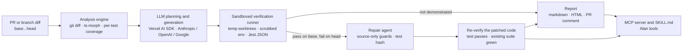

# TestPilot

TestPilot turns a code change into evidence: a regression test that passes on
base, fails on head, and a source fix the runner proves.

Agents ship changes faster than tests keep up. A "small" performance change
like `Promise.all` or `.lean()` can pass every existing test and still break
behaviour. TestPilot finds that gap and shows its work.

## What it proves

```
Change -> Risk -> Test -> Evidence -> Fix -> Proof
```

- **Change:** diff `base...head`, map changed functions, callers and per-test coverage.
- **Risk:** an LLM plans failure scenarios from the base behaviour, not from invented requirements.
- **Test:** it writes one Jest regression test and requires it to compile and pass on base.
- **Evidence:** the same test runs on head. A verified failure means it fails there for a behavioural reason.
- **Fix:** for a verified failure, a repair agent proposes a source-only patch.
- **Proof:** the test passes on the patched code, the existing suite stays green, and the test file is byte-identical.

Verdicts come from exit codes and parsed Jest JSON. The LLM proposes scenarios and
edits; it never decides whether a test passed.

## Architecture



The same diagram lives in [`docs/architecture.mmd`](docs/architecture.mmd).

## Quickstart

Requires Node 20+ and git.

```bash
npm install
cp .env.example .env            # set one provider key
npm run preflight               # fast, no LLM calls
npm run demo                    # offline replay with the report page
npm run demo -- --live          # real loop against ../demo-shop
```

Other entry points:

```bash
npm run dev -- analyze --repo ../demo-shop --base main --head bug/user-lean
npm run dev -- report --run <runId> --format html --out report.html
npm run dev -- serve --port 4317
npm run dev -- mcp              # MCP over stdio
npm run check-verification
npm run check-repair
npm run check-alan-integration
npm run final-check
```

### MCP registration

The server exposes seven tools: `analyze_pull_request`,
`generate_regression_tests`, `run_regression_tests`, `repair_regression`,
`get_verification_report`, `run_testpilot_loop` and `get_run_status`.

Use `alan/mcp-config.example.json` as a generic stdio shape. Alan's exact config
format is not known; adapt the mapping and keep keys in a secret manager. The
skill is at [`alan/skills/testpilot-verify/SKILL.md`](alan/skills/testpilot-verify/SKILL.md).

## Verdicts and honesty

| Verdict | Meaning |
| --- | --- |
| `regression_caught` | Stable pass on base, stable behavioural fail on head (and pass on fixed when supplied). Only this is a verified failure. |
| `regression_caught_suspect` | Base passes and head fails, but the failure is compile/timeout, outside changed code, or still fails on fixed. Needs human review. |
| `not_demonstrated_passes_both` | The test passes on both revisions, so it does not detect the change. |
| `invalid_fails_on_base` | The test fails, errors or does not compile on base. |
| `flaky` | Status changed across repeated runs on at least one revision. |
| `inconclusive` | Infrastructure problem, such as a base timeout. |

Repair statuses: `fixed` (the fix keeps a changed implementation), `fixed_by_revert`
(the fix restores the base behaviour, so the PR intent was not preserved),
`failed` (attempts exhausted) and `skipped` (no verified regression to repair).

Confidence is `high` only for `regression_caught` with at least three stable runs
per revision and a failure location inside a changed file.

## Security model

- **Allowlisted repos:** `TESTPILOT_ALLOWED_REPOS` is resolved with `realpath`; symlink escapes are rejected.
- **Validated refs:** refs match `^[A-Za-z0-9._/@-]+$`, may not start with `-`, and must resolve with `git rev-parse --verify`.
- **Scrubbed children:** tests run with only PATH, a temp HOME, TMPDIR, `NODE_ENV=test` and `CI=true`; provider keys are never visible.
- **Patch guards:** source-only files, no test tampering, a 3-file/60-line budget, no hardcoded test literals, and `tsc` must pass.
- **Escaped output and localhost only:** HTML is escaped once in `esc()`, reports make no external requests, and the report/MCP HTTP servers bind to `127.0.0.1`.

## Results

Numbers below are copied from [`docs/STATS.md`](docs/STATS.md), which records the
source and `n` for each one.

- Verification controls: **11/11** (n=11), repair controls: **9/9** (n=9), Alan integration checks: **21/21** (n=21).
- Live loop runs: **regression_caught 4/4** (n=4), **fixed 0**, **fixed_by_revert 4** (n=4).
- Valid generated tests: **4/4** (n=4); average repair attempts: **1** (n=4).
- Tokens across four runs: **64,685**; per run: 15,684 / 22,249 / 13,737 / 13,015.
- Average wall-clock per stage (n=4): generate **56,261 ms**, repair **30,797 ms**, verify **12,804 ms**, analyze **717 ms**.
- Generation acceptance was blocked at the time (no provider keys); the later live loop runs superseded it.

The live numbers come from one provider (Google, `gemini-3.8-flash`) on two planted
bugs. They are not a benchmark across models or repositories.

## Known limitations

- One language and one test framework: TypeScript and Jest.
- The demo repo has two planted bugs; that is not a broad codebase evaluation.
- Coverage is mapped per test file, not per test case.
- Isolation is a process sandbox; Docker mode exists but was not exercised here.
- Repair guards are heuristic. `noHardcoding` only checks added lines against string/number literals from the test.
- LLM output varies. Generated tests can encode a wrong oracle, which is why base-pass is required and suspect verdicts exist.
- The per-repo busy guard is in-process only.

## Roadmap

Mutation testing for stronger oracles; richer dependency analysis; more languages
and runners; automatic re-test on PR updates.

## Docs

- [`docs/DEMO.md`](docs/DEMO.md) - timed demo script, fallback ladder, Q&A.
- [`docs/slides/index.html`](docs/slides/index.html) - 3-slide deck.
- [`docs/STATS.md`](docs/STATS.md) - every number with its source.
- [`docs/SUBMISSION.md`](docs/SUBMISSION.md) - submission checklist.

## License

MIT. See [`LICENSE`](LICENSE).
